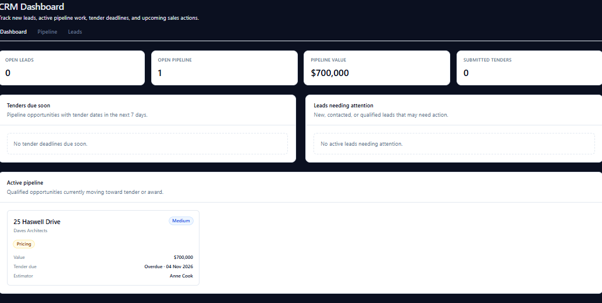
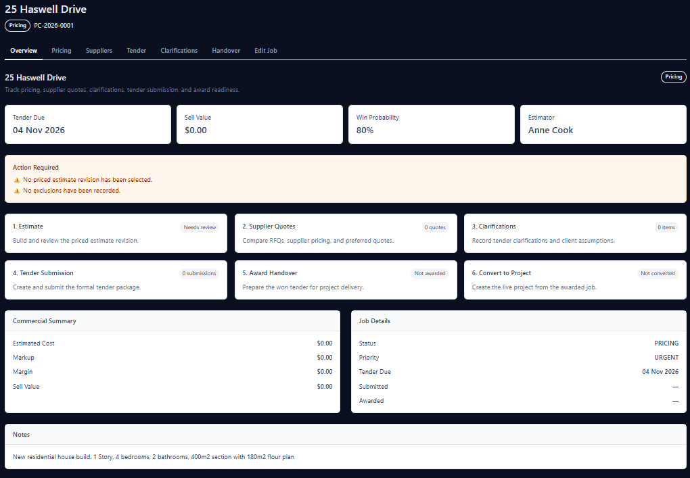
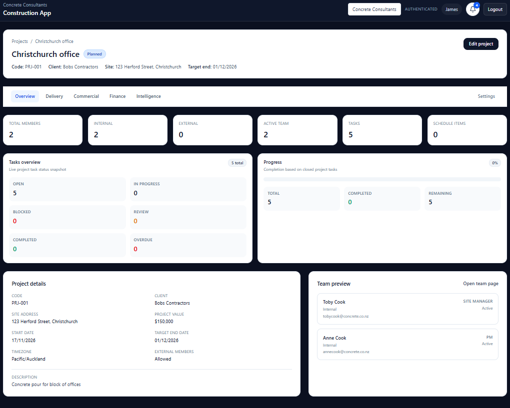
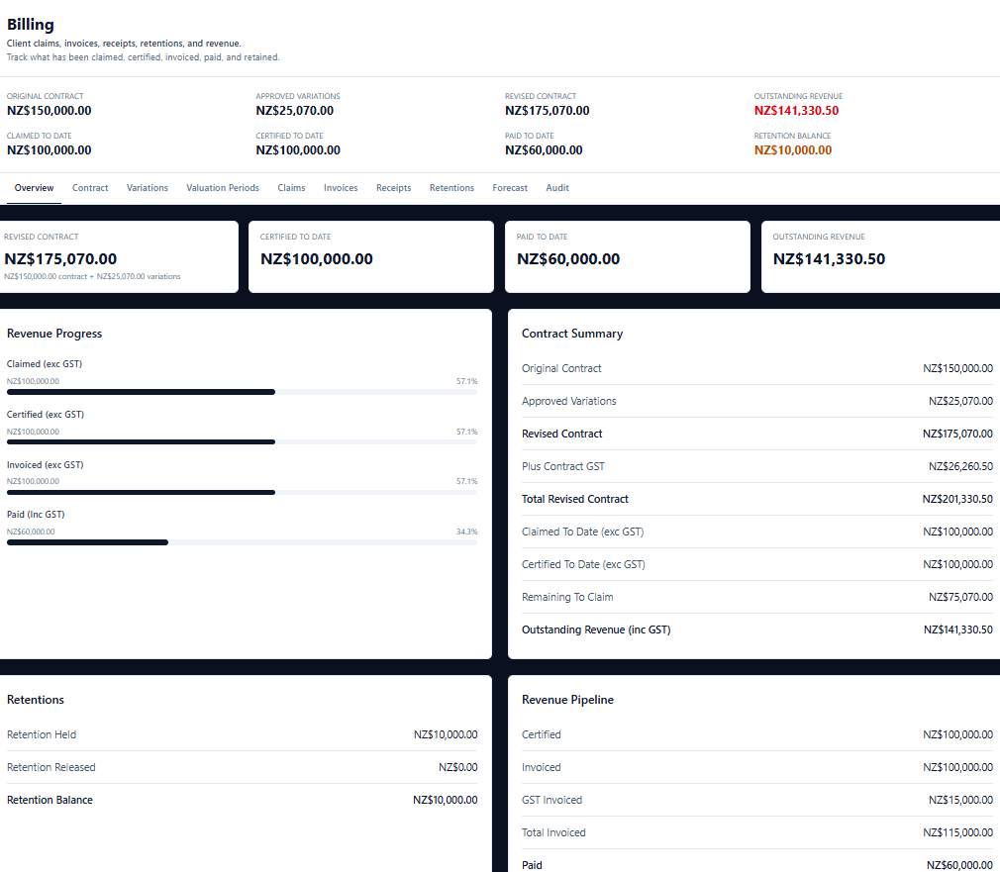
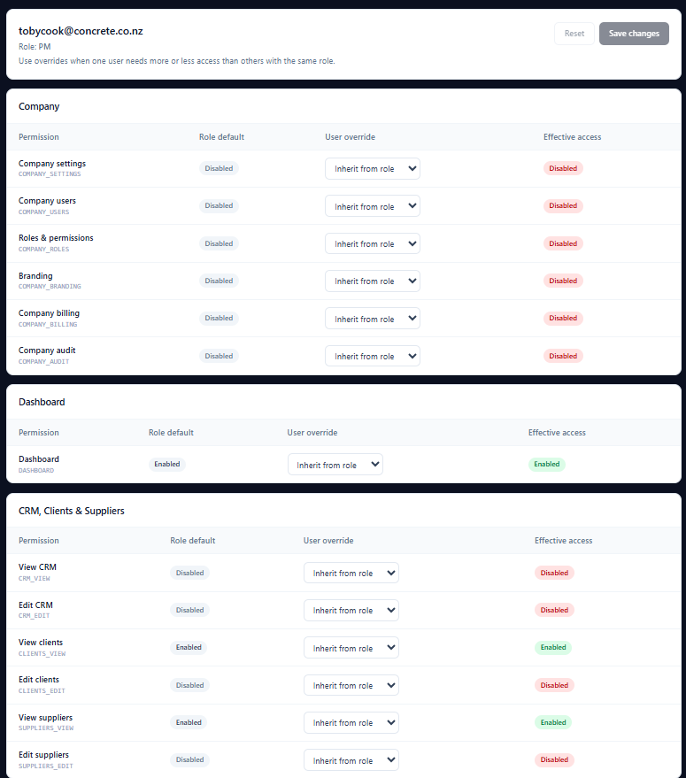
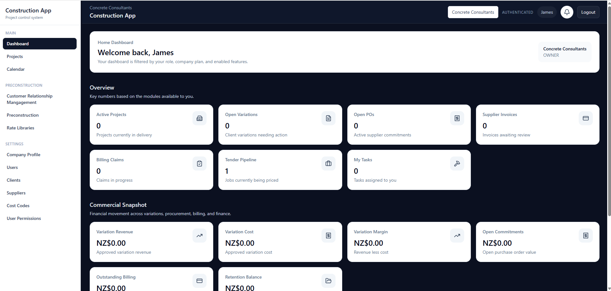

# Construction QS App

A full-stack construction management platform designed to help small and medium-sized construction businesses manage their operations, from initial opportunities and tendering through to project delivery and financial administration.

**Status:** Independently developed, progressing towards beta release  
**Developer:** Independent software developer  
**Target market:** New Zealand construction industry

---

## Project Overview

Construction QS App is a SaaS application designed to provide construction businesses with a centralised system for managing their day-to-day operations.

The platform brings together tender management, project coordination, commercial administration and financial workflows, reducing the need to manage business information across multiple disconnected systems.

The application has been designed with the needs of small and medium-sized construction companies and subcontractors in mind, particularly businesses involved in tender-driven construction work.

## Key Features

### Tender Management
- Track business opportunities and incoming tender invitations.
- Manage tender preparation and submission workflows.
- Record pricing, quotations, exclusions and terms and conditions.
- Track submitted, accepted and unsuccessful tenders.

### Project Management
- Organise projects and project information.
- Manage schedules, tasks and team responsibilities.
- Maintain project documentation.
- Support coordination between office and site-based personnel.

### Commercial and Financial Workflows
- Manage project variations and purchase orders.
- Track invoices, receipts and payment claims.
- Support retention and cost-code management.
- Organise supplier pricing information.

### Organisation and Access Management
- Multi-tenant architecture supporting separate business organisations.
- Role-based access control.
- Permissions designed around different responsibilities within a construction business.
- Organisation-level data isolation.

## Technology Stack

| Area | Technologies |
|---|---|
| Frontend | React, TypeScript, Vite |
| UI and state | Tailwind CSS, Zustand, TanStack Query |
| Backend | Node.js, Express, TypeScript |
| API | REST APIs, Zod |
| Database | PostgreSQL, Prisma ORM |
| Authentication | Firebase Authentication, Firebase Admin |
| Cloud storage | Cloudflare R2 |
| Database hosting | Neon |
| Backend hosting | Render |
| Frontend hosting | Vercel |
| Version control | Git, GitHub |

## Application Architecture

The application uses a separated frontend and backend architecture.

**Frontend**
- React and TypeScript provide the user interface.
- TanStack Query manages server data and API interactions.
- Zustand manages client-side application state.

**Backend**
- Node.js and Express provide the application API.
- REST endpoints handle business operations and data access.
- Zod is used for request validation.
- Prisma ORM provides database access and management.

**Data and Infrastructure**
- PostgreSQL stores application data.
- Prisma manages the database schema and queries.
- Firebase handles authentication.
- Cloudflare R2 provides object storage.
- The frontend and backend are deployed separately.

## Security and Data Architecture

Security and organisation-level data separation have been important considerations throughout development.

Key design considerations include:

- Multi-tenant data architecture.
- Organisation-level data isolation.
- Role-based access control.
- Authentication through Firebase.
- Server-side validation of incoming API requests.
- Controlled access to financial and business information based on user permissions.

## Development Responsibilities

This project has been independently designed and developed, covering the full application development process.

My responsibilities have included:

- Application architecture and technical design.
- Frontend development and user interface implementation.
- Backend API development and business logic.
- Relational database design and schema management.
- Authentication and authorisation.
- Multi-tenant architecture and access control.
- Cloud service integration and deployment.
- Debugging, application testing and troubleshooting.
- Source control and ongoing development using Git and GitHub.

## Technical Challenges and Engineering Decisions

### 1. Multi-Tenant Application Architecture

Designed the application to support multiple independent construction businesses within a shared platform.

- Developed an organisation-based data architecture.
- Implemented organisation-level data separation.
- Considered tenant isolation throughout database design and backend API development.
- Designed the system to support multiple users and organisations.

### 2. Role-Based Access Control

Developed an access-control system to manage permissions across different organisational roles.

- Implemented user roles and permission-based access.
- Designed access restrictions around different responsibilities within construction businesses.
- Applied server-side authorisation to protect restricted functionality and business information.
- Considered financial data visibility and access restrictions.

### 3. Relational Database Design and Business Logic

Designed the database and backend functionality to support interconnected construction business workflows.

- Developed relational database structures using PostgreSQL and Prisma ORM.
- Built REST APIs using Node.js and Express.
- Implemented backend business logic for tenders, projects and financial workflows.
- Used request validation to improve data integrity and API reliability.

## Project Status

The application has progressed through its core development and testing stages and is being prepared for beta release.

Development is ongoing, with a focus on final validation, usability and preparing the platform for initial users.

## Application Screenshots

### Main Dashboard
Overview of business activity and key operational information.

### Customer Relationship Management
Managing business opportunities, leads and customer relationships.

### Tender Management
Overview of tender opportunities and tender workflows.

### Project Management
Project-level overview and coordination.

### Project Financial Management
Financial overview and commercial administration at project level.

### User and Access Management
Managing organisation users, roles and access permissions.

### Layout
Overall layout

## Additional Documentation

- [Application Architecture](architecture.md)
- [Application Screenshots](#application-screenshots)

---

*This is an independently developed software project. The public repository contains project documentation and selected visual material only; the application source code is maintained separately in a private repository.*
